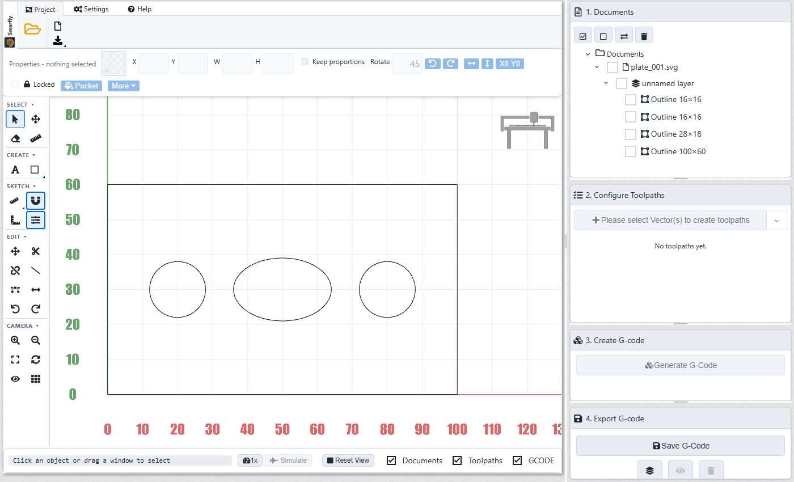
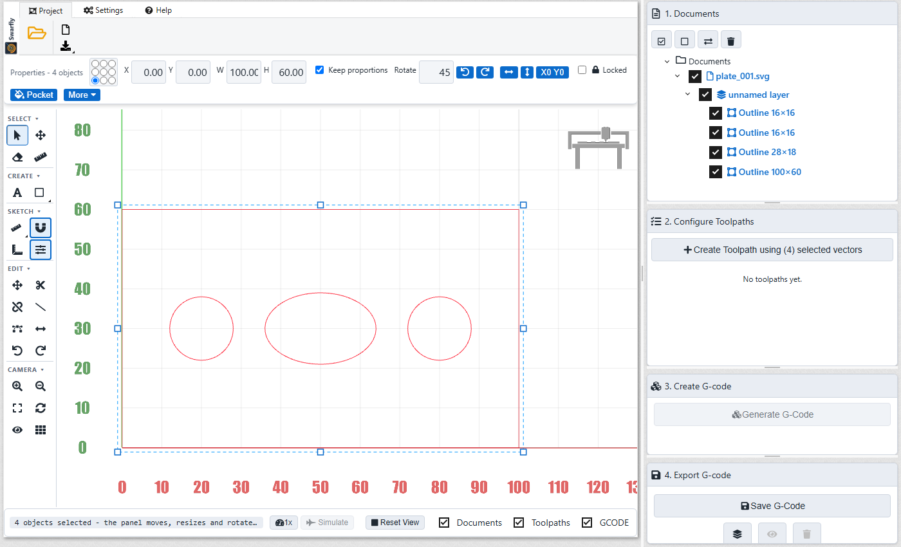
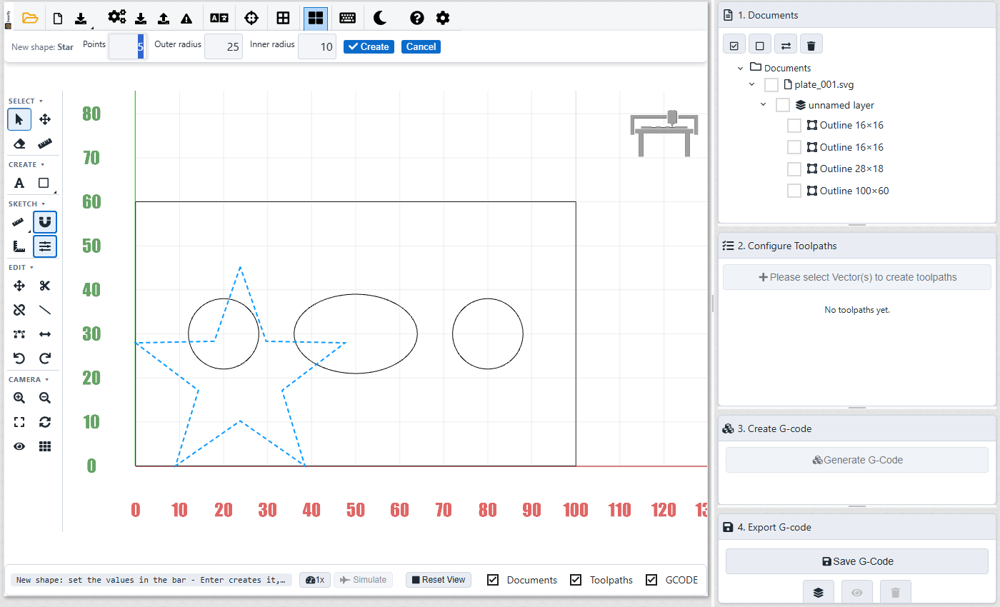
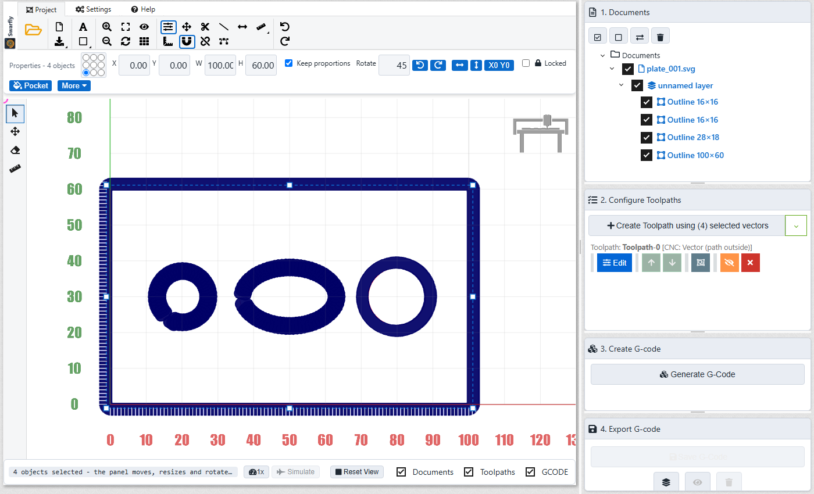
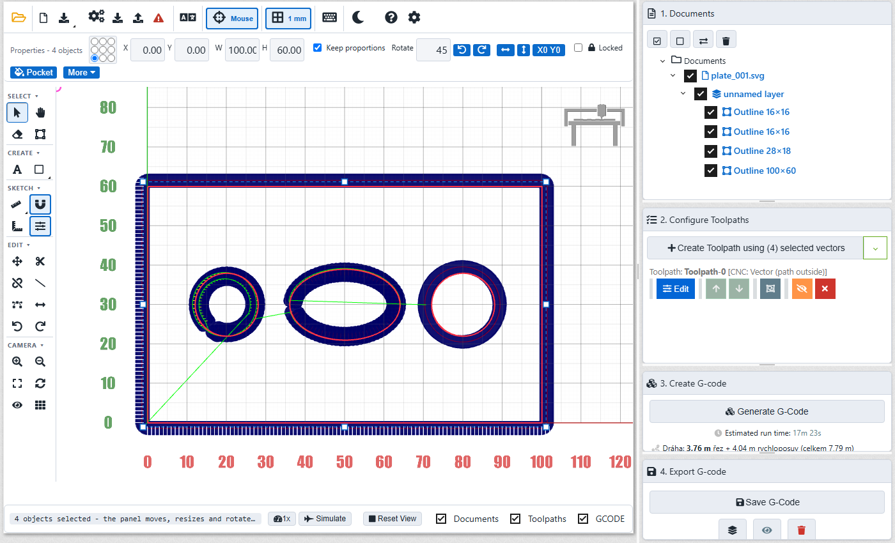
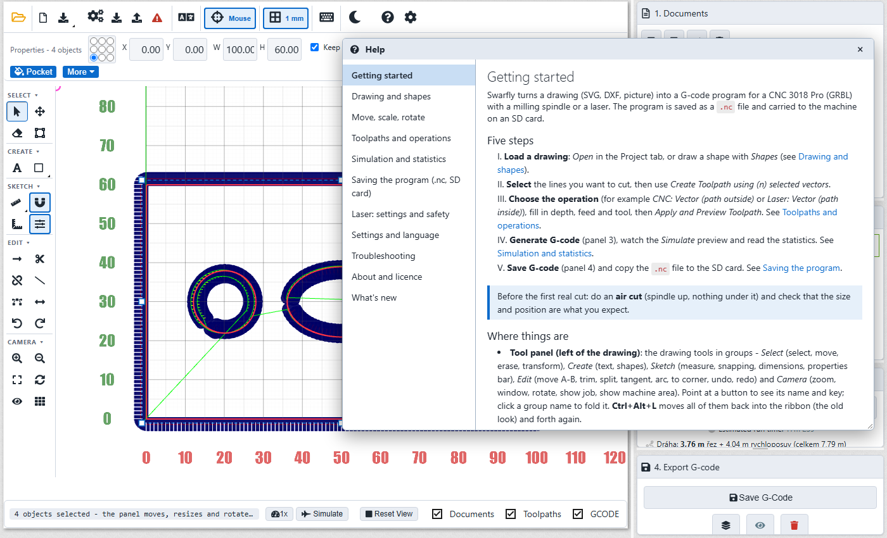
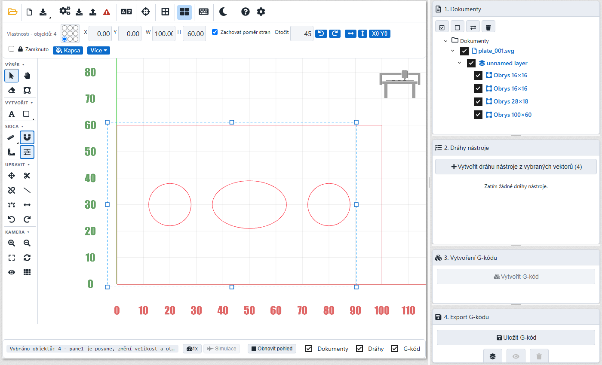

# Swarfly

**Swarfly** is a CAM program for small hobby CNC machines, made for a **CNC 3018 Pro** (GRBL 1.1, offline controller with OLED and SD card). You draw or import a shape, choose what the machine should do, and get a G-code file for the SD card - with the same plain style as the programs the machine already runs well.

It is a fork of [OpenBuilds CAM](https://github.com/OpenBuilds/OpenBuilds-CAM) (AGPL-3.0). All credit for the original software goes to the OpenBuilds authors; the original licence (`LICENSE`) applies to this fork too.

## What Swarfly adds

- **Drawing and editing** like in a simple CAD: shapes (circle, rectangle, rounded rectangle, ellipse, polygon, star, slot, text) set up in a properties bar; move, scale and rotate with handles; snap to points and grid; measuring; trim, split, corners (fillet, chamfer), tangent line and arc, extend to a corner, pockets, arrange and align.
- **Import** of DXF, SVG, bitmaps (with tracing to outlines) and Gerber; DXF units are respected.
- **G-code made for the 3018**: machine preset, a G-code check, program statistics and time estimate, 8.3 file names for the SD card, **one file per tool** when the bit has to be changed by hand.
- **Czech and English** user interface and an in-app help (F1), with a "What's new" page.
- **Camera for a mouse without wheel and middle button** (trackball): Zoom +/-, zoom to a window, Rotate tool, Shift = rotate, Ctrl+Shift = zoom.
- A desktop app for Windows (installer and portable exe); nothing is sent anywhere.

See [`CHANGELOG.md`](CHANGELOG.md) for the full list by version.

## Screenshots

| | |
|---|---|
|  **Drawing area with the document tree and the four panels** |  **Properties bar: position, size, rotation, pocket** |
|  **A new shape is set up in the bar** |  **Toolpath preview** |
|  **G-code with time estimate and statistics** |  **Built-in help (F1)** |
|  **Czech user interface** | |

## Status

Used and tested in the browser and in automated tests. A first real cut on the machine has **not** been made yet - check every program in the simulation and with an air cut (Z raised) before cutting material. You use it at your own risk.

## Download

Download the installer (`Swarfly-Setup-<version>.exe`) or the portable `Swarfly-<version>.exe` from the [Releases](https://github.com/jaranovy/swarfly/releases) page. The installed program **updates itself** from there (only the changed parts are downloaded). Windows may show a SmartScreen warning because the files are not code-signed.

## Run from source

```sh
npm install
npm start            # desktop app
# or in a browser: serve the folder over HTTP (not file://) and open index.html
python -m http.server 8100
```

`npm run dist:win` builds the Windows installer and the portable exe into `dist/` and copies them to `out/`.

## Tests

```sh
npm test                                  # unit tests (node:test), about a second
npx playwright test test/e2e/<file>       # browser tests; the whole suite takes several minutes
```

More in [`docs/DEVELOPMENT.md`](docs/DEVELOPMENT.md).

## Documentation

- In the app: **Help** tab or **F1**. The same topics are Markdown files: [`help/en/`](help/en) and [`help/cs/`](help/cs).
- [`docs/ARCHITECTURE.md`](docs/ARCHITECTURE.md) - how the project is built, what Swarfly added, data flow of a job.
- [`docs/EXTENDING.md`](docs/EXTENDING.md) - how to add a **language**, a **skin**, a help topic, another machine or an editor tool.
- [`docs/DEVELOPMENT.md`](docs/DEVELOPMENT.md) - running, testing, building, release checklist.
- [`CHANGELOG.md`](CHANGELOG.md) - what changed in each version.

## Licence and credits

AGPL-3.0, see [`LICENSE`](LICENSE). Swarfly is based on OpenBuilds CAM by the OpenBuilds team and on the DrMoriarty fork of it. Bundled libraries keep their own licences.

---

## About the original project (OpenBuilds CAM)

cam.openbuilds.com
OpenBuilds CAM - Cloud based software for converting DXF, SVG, Bitmap (BMP, JPG, PNG, GIF) and Gerber X274 to G-Code


Access it live at [https://cam.openbuilds.com](https://cam.openbuilds.com)

## Running as a website

Serve the repo root over HTTP and open it in a browser (do **not** use `file://`):

```sh
python3 -m http.server 8000
# open http://localhost:8000
```

## Running as a desktop app (Electron)

The same static app is packaged as a cross-platform desktop app (Windows / macOS / Linux) via Electron. The Electron main process (`electron/main.js`) serves the repo root through a custom `app://` protocol, so Web Workers, `importScripts` and `$.get` of workspace files keep working unchanged; Google Analytics requests are blocked in the desktop build.

```sh
npm install          # pulls electron + electron-builder (dev-only)
npm start            # launch the desktop app in dev mode
npm run dist         # build installers into dist/ (NSIS for Win, DMG for macOS, AppImage for Linux)
npm run dist:win     # only Windows
npm run dist:mac     # only macOS
npm run dist:linux   # only Linux
```

Notes:

- The app payload is everything except `partslib/` and `node_modules/` (see `build.files` in `package.json`); `partslib/` is an unrelated offline conversion script and is excluded.
- App icon lives at `build/icon.png` (512×512 PNG; electron-builder converts it to `.ico`/`.icns`).
- The web version at cam.openbuilds.com is unaffected — `electron/` and `package.json` are simply ignored by the static hosting.
